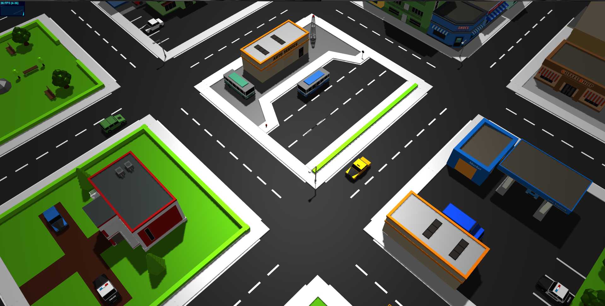

# Endless City

Endless City is an interactive low-poly WebGL city that streams a deterministic neighborhood around the camera. It preserves the original project’s models and elevated map-like visual style while adding genuinely unbounded travel, fixed-step four-direction traffic, mobile support, and bounded object pools.

## Preview



## Explore

- Mouse: drag to move and scroll to zoom. Movement eases to a stop, and the viewing angle stays fixed.
- Touch: drag with one finger to move; pinch or drag with two fingers to move and zoom.
- Presentation: once loading completes, the canvas is the entire interface. Loading, recovery, and Retry appear only when the scene is unavailable.

Traffic adapts once at startup to the viewport. High quality uses 72 vehicle slots, balanced uses 48, and viewports narrower than 768 CSS pixels use 28. Every profile retains eastbound, westbound, northbound, and southbound traffic.

Each vehicle receives stateless, seed-derived driver traits for cruise speed, acceleration, braking, headway, and minimum gap. Route decisions start from a 55% straight, 22.5% left, and 22.5% right distribution, with a bounded profile adjustment to the straight share. Turns follow smooth curves between the authored incoming and outgoing lane centerlines. The stationary-camera acceptance floors require the 72-car profile to retain all 72 active slots and, after warm-up, at least 18 cars inside the protected radius with at least 11 of those moving. Across the verified 216,000-step run, the observed sample minima were 72 active, 35 visible, and 30 moving-visible cars. The moving-camera regression also requires at least 18 visible cars and all four visible directions in every one-minute window.

## Run locally

Prerequisites:

- [Bun](https://bun.sh/) with its current stable runtime
- A current browser with WebGL and hardware acceleration

Install dependencies and start the Vite development server:

```powershell
bun install
bun run dev
```

Vite prints the local URL. Open it in the browser; source edits reload automatically.

## Verify and build

Run each project gate independently:

```powershell
bun run typecheck
bun run test
bun run build
```

The build command runs strict TypeScript checking and emits a production site to `dist/`. Deploy the contents of `dist/` to any static host. The application uses root-relative URLs, so host it at the domain or configured site root.

## Project structure

- `src/city/` — logical coordinates, deterministic layout, tile windows, and render-origin shifts.
- `src/traffic/` — seeded driver traits, lane and turn geometry, fixed-step following, movement conflict zones, spawning, and hidden recycling.
- `src/rendering/` — one-time asset loading, quality selection, Three.js scene setup, and pooled city/traffic views.
- `src/camera/` — map controls and bounded render-local camera coordinates.
- `src/ui/` — loading, recovery, and failure states shown only while the scene is unavailable.
- `src/app.ts` and `src/main.ts` — application lifecycle and browser bootstrap.
- `tests/` — deterministic unit, integration, lifecycle, and existing-asset contract tests.
- `js/clusters/` — the original GLTF/GLB visual assets reused by the redesign.
- `docs/architecture.md` — maintainer guide to streaming, traffic, rendering, and errors.
- `docs/legacy-audit.md` — original failure analysis and replacement invariants.

## Asset constraint

The city and vehicle visuals continue to use the existing files in `js/clusters/`. The only runtime-generated visual is the bounded five-cloud low-poly atmosphere built from shared Three.js primitives; it adds no image, texture, model, or network asset. `preview.png` remains the project preview.

## License

Released under the [MIT License](./LICENSE). Copyright © 2018 Tomasz Zielinski.
