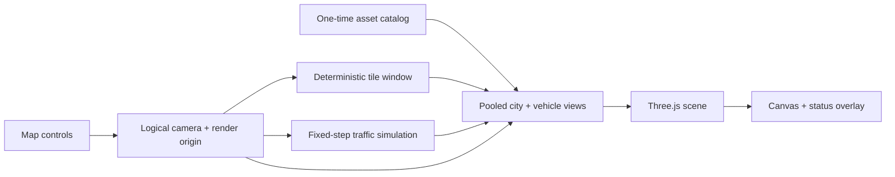

# Architecture

Endless City separates an unbounded logical world from a small, bounded Three.js scene. Pure TypeScript modules decide what exists and how traffic moves; rendering adapters project that state around a shifting local origin.



## Coordinate model and city streaming

`src/city/types.ts` distinguishes integer `GridCoordinate` block addresses from continuous logical `WorldPoint` positions. `BLOCK_SIZE` is 60 units, matching the authored road and building assets. There is no logical board boundary.

`src/city/hash.ts` hashes the fixed world seed with signed X/Z coordinates. `src/city/layout.ts` turns that hash into a weighted building choice and a quarter-turn rotation. A salted local neighbor rule reduces obvious repetition without visitation-order state. Consequently, the same coordinate always returns the same building and rotation, including after leaving and revisiting it or approaching it from another direction.

`src/city/tile-window.ts` enumerates the fixed odd-sized neighborhood around the logical camera cell. `src/rendering/city-view.ts` owns exactly `tileDiameter²` building slots: 81 for high quality or 49 for balanced/mobile. On movement it retains still-visible assignments, releases the departed edge, and assigns those slots to entering coordinates. Ordinary travel creates no additional building slots.

The road is a single existing repeated mesh placed at a 60-unit offset. Tile positions use `coordinate × 60` plus a rotation-specific 0/20-unit plot correction. Because origin shifts are also whole 60-unit multiples, roads and plots stay aligned through recentering.

## Render-origin shifts

Unbounded logical coordinates are unsuitable as ever-growing Three.js transforms. `src/city/origin.ts` therefore tracks an unbounded logical origin and a render-local camera. Once either local X/Z axis exceeds 120 units, it moves the camera and controls target by the nearest whole-block shift and adds that shift to the origin.

All visible transforms use:

```text
render position = logical position - render origin
```

`src/camera/controller.ts` owns this conversion. City and traffic simulation coordinates are never rewritten during a shift, so camera recentering cannot change tile identity, lane gaps, reservations, or recycling decisions. Local camera coordinates remain bounded to a small neighborhood of the renderer origin.

## Asset and view lifecycle

`src/rendering/assets.ts` requests the road, 15 building prototypes, and `cars.gltf` once. Building scenes are cached and cloned into tile slots. A failed building uses the existing park prototype when available, then an empty plot; the required road has no silent fallback.

Each directed root in `cars.gltf` becomes a vehicle prototype. The loader validates direction extras as one of `(1, 0)`, `(-1, 0)`, `(0, 1)`, or `(0, -1)`, measures length from its bounds, and exposes immutable metadata to the simulation. `src/rendering/traffic-view.ts` allocates one render slot per simulation slot and interpolates between previous/current progress. A recycled slot may exchange its cloned prototype, but the slot count remains fixed.

## Traffic simulation

### Lanes and following

`src/traffic/lanes.ts` represents each straight road as a direction plus an integer line. Scalar progress always increases. East/south use the authored `-16` transverse offset; west/north use `-23`. Direction alone maps progress onto positive or negative X/Z, eliminating parent-transform corrections.

`src/app.ts` feeds elapsed render time to `consumeFixedSteps`. The accumulator caps long frames at 0.1 seconds and advances `TrafficSimulation` at exactly 1/60 second per step. `src/traffic/following.ts` groups active vehicles by lane, orders them by progress, applies minimum-gap/time-headway acceleration and braking, and clamps progress so a follower cannot cross its leader. Rendering interpolation affects presentation only.

### Intersection reservations

Crossing centers repeat every 60 units with the road asset’s `-20` offset. `src/traffic/intersections.ts` gives each conflict zone at most one reservation. Approaching vehicles are ordered by distance to the stop line, then stable vehicle ID; the winner holds the reservation until its rear bumper leaves the zone. A loser treats the stop line as a zero-speed logical leader. Perpendicular traffic therefore cannot occupy the same conflict zone.

### Hidden recycling

`src/traffic/spawning.ts` keeps the simulation centered around the logical camera. A vehicle is eligible for recycling only outside the configured simulation radius and never inside the 120-unit protected visible/fog-transition radius. Deterministic candidates are generated beyond fog and accepted only when front/rear gaps and intersection occupancy are safe. If no candidate is safe, the slot becomes inactive and retries later. Recycling cannot be visible and never changes the number of simulation or render slots.

## Quality profiles

`src/rendering/quality.ts` selects one profile at startup so resizing does not cause visible density oscillation.

| Profile | Selection | Tile window | Vehicle slots | Pixel-ratio cap | Shadow map |
| --- | --- | ---: | ---: | ---: | ---: |
| High | width ≥ 1200 and DPR ≤ 2 | 9×9 | 49 | 1.5 | 2048 |
| Balanced | width 768–1199 or DPR > 2 | 7×7 | 32 | 1.25 | 1024 |
| Mobile | width < 768 | 7×7 | 20 | 1 | 1024 |

Every traffic profile includes all four directions. `src/rendering/scene.ts` uses modern sRGB output, capped pixel ratio, fog, and profile-sized soft shadows.

## Error and application lifecycle

`src/app.ts` owns startup, the animation frame, visibility/resize listeners, pause/resume, and disposal. Loading progress flows from the asset catalog to `src/ui/overlay.ts`. Optional asset failures degrade to existing fallbacks; required road failure, WebGL creation failure, or a frame exception stops the owned loop and shows a concise error with retry. WebGL context loss pauses the loop and exposes a restoring state; restoration resumes the existing application. Default diagnostics are hidden, while `?debug=1` enables the FPS output.

## Non-goals

- Turning vehicles, pedestrians, traffic lights, and public-transport behavior.
- Saved worlds, user-generated layouts, multiplayer, or server persistence.
- Procedural geometry or new visual assets.
- Day/night cycles, weather, interiors, or free-flight controls.
- A physically realistic traffic model; the goal is deterministic, visually safe ambient motion.
